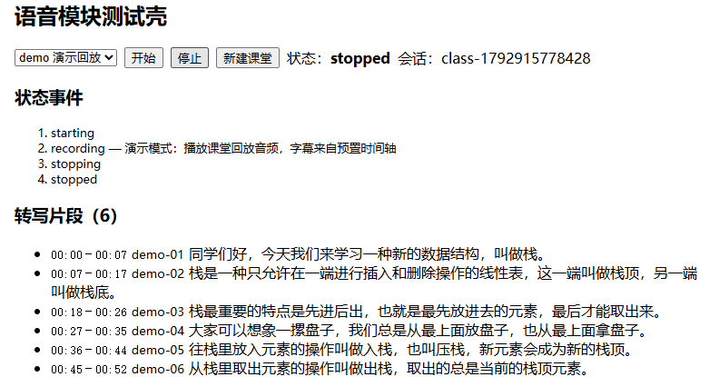

# 走神急救按钮 · 课堂语音模块 · 项目说明

更新日期：2026-10-25；代码验证基线：`9419533`。

公开代码仓库：https://github.com/HikariHoshino/classroom-rescue-speech

本项目面向课堂中短暂分心、未听清或需要回看讲授内容的学生，提供课堂音频采集、标准化转写接入和带时间戳的回放能力，为主应用的课堂回溯、疑似考点和课后笔记提供统一的文字片段。

本次提交是独立的语音模块代码交付，不是包含 AI 回溯、考点雷达和笔记导出的完整课堂应用。当前已完成本地回放演示和模拟服务联调，真实 ASR 与实体麦克风的最终验收仍待完成。

## 1. 使用场景与交付定位

课堂场景需要先把持续音频可靠地整理成可更新、可定位的文字记录。语音模块将浏览器音频采样、服务连接、结果去重、会话切换和停止收尾集中处理，让上层页面只接收统一片段与状态，不直接依赖服务商原始响应。

## 2. 当前可验证的功能

| 功能 | 已实现内容与验收边界 |
| --- | --- |
| 课堂回放 | 播放约 104 秒的“栈”主题占位音频，按预置时间轴逐段输出；字幕不是现场 ASR 结果。 |
| 音频采集链路 | AudioWorklet 输出 16 kHz、16-bit、单声道 PCM，每常规块 200 ms；已通过 Chrome 合成麦克风联调。 |
| 服务接入 | 实现火山引擎流式 ASR 适配和后端鉴权；尚未使用有效凭据完成真实识别验收。 |
| 片段标准化 | 输出确认分句；相同起始时间生成稳定 ID，内容修正沿用该 ID，便于主应用覆盖更新。 |
| 生命周期 | 重复开始和停止、旧会话释放、断线错误、尾包及最终结果等待，均有本地测试覆盖。 |
| 录音转写工具 | 可将 WAV 送入识别链路；最终结果等待默认 5 秒，超时退出且不覆盖现有时间轴。 |

作品入口：公开代码仓库。当前未发布公网在线演示；127.0.0.1 是开发电脑的本地地址，不应填入报名表作为评委可访问的作品链接。

## 3. 技术路线与模块接口

实时链路为“浏览器麦克风 → AudioWorklet 重采样 → /ws/asr → 后端火山协议适配 → 确认分句 → 标准 Segment 回调”。演示模式使用同一套回调，音频加载失败时明确切换为预置文本回放。

| 接口或目录 | 作用 |
| --- | --- |
| startSpeech / stopSpeech | 启动指定课堂会话，回调片段与状态；主应用按 sessionId 隔离旧回调。 |
| Segment | 字段为 id、startMs、endMs、text；时间单位为本节课起点后的毫秒。 |
| registerAsrRoutes | 由整合方在 HTTP Server 挂载语音 WebSocket 路由；密钥只在后端读取。 |
| 前后端语音目录 | src/speech 负责浏览器输入，server/asr 负责后端适配；公共类型、主应用和依赖锁文件由整合方提供。 |

## 4. 已完成的验证

代码验证基线为 9419533，环境为 Windows、Node v22.18.0 和本机 Chrome。前后端类型检查、Vite 构建、9 项 Node 单元／集成测试及 9 项浏览器检查均通过，未跳过测试。浏览器音频测试使用合成麦克风及本地模拟 ASR，不代表真实识别准确率或实体设备已验收。

验证覆盖回放 12 段完整输出、重复操作、同 ID 修正去重、尾包送达、音频丢失兜底、断线资源释放、最终结果缺失提示和 390 px 视口。另先复现了并发会话残留和录音转写无限等待，再验证对应修复。



## 5. 仓库内容与接入方式

仓库包含 src/speech/、server/asr/、public/demo/lecture.wav、回归测试、README 和验收记录。依照原交接约定，临时公共类型、应用页面、服务入口及工程配置不随模块提交，因此该仓库不是可单独执行 npm run dev 的完整工程。

整合方将模块目录放入约定的 React／TypeScript／Vite 与 Node／Express 应用，提供 shared/types.ts，安装 ws 及对应开发依赖，挂载 registerAsrRoutes，并将 /ws 代理到后端且启用 WebSocket。完整接入约定见仓库 README。

## 6. 检查命令与演示步骤

```sh
npm run check
npm run build
node --import tsx --test src/speech/session.test.ts server/asr/asr.test.ts
```

检查命令在整合后的应用工程根目录执行，不是在缺少公共工程文件的模块独立仓库中直接运行。

本地回放演示选择 demo 后开始，等待逐段字幕，停止后确认原文保留。采集联调选择 live，在正常 Chrome 中由用户点击开始并授权麦克风；模拟服务显示“模拟识别”和音量，不把模拟文字当作用户实际讲话内容。

## 7. 待完成的正式验收

| 验收项 | 所需条件与通过标准 |
| --- | --- |
| 真实 ASR | 配置有效后端凭据和已开通资源，以录音工具或实时链路得到可核对的实际识别文字。 |
| 实体麦克风 | 在演示电脑验证有效声音、断开与停止后的设备释放；已收到音频包不等于已确认声音有效。 |
| 正式演示素材 | 收到团队正式录音后再生成时间轴，保留旧版本恢复点，不用模拟识别覆盖演示内容。 |
| 完整应用整合 | 取得主应用代码后对齐公共类型、状态管理、路由和错误提示，再开展整条产品流程验收。 |

## 8. 提交材料使用方式

报名表第 10 项可填写下方公开代码仓库地址；第 11 与第 12 项按页面提示二选一，本次选择第 12 项上传随仓库提供的 Word 项目说明。未取得飞书模板原文，因此本说明不声称已经覆盖该模板的所有字段。团队成员、TRAE 实际使用过程和主应用成果应由团队按真实记录补充。

https://github.com/HikariHoshino/classroom-rescue-speech
